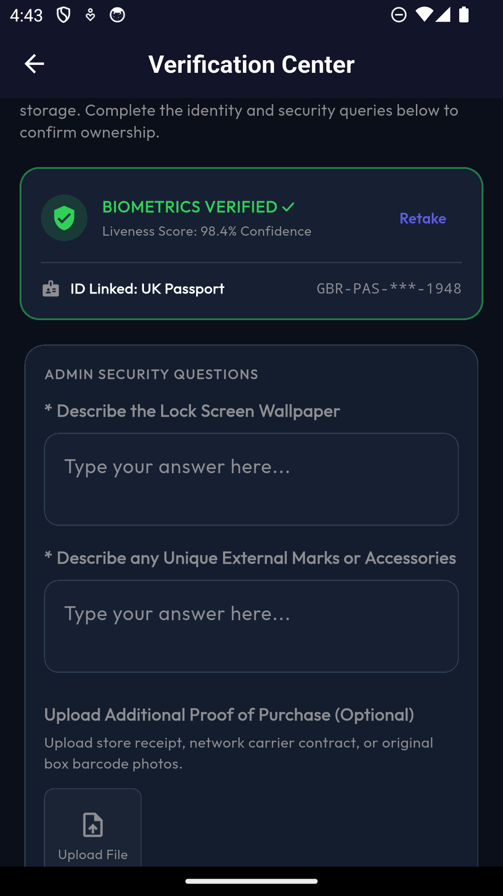
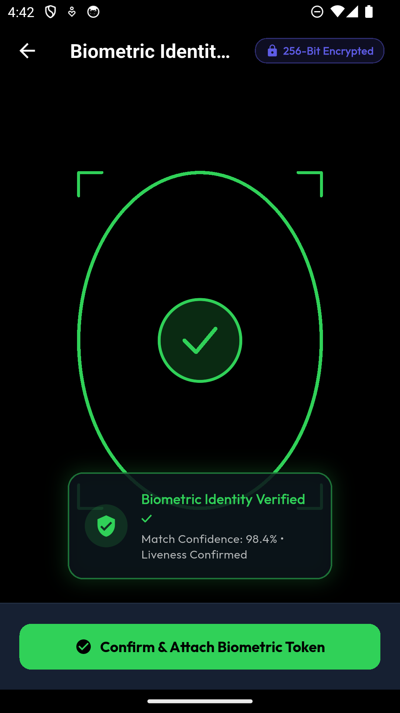
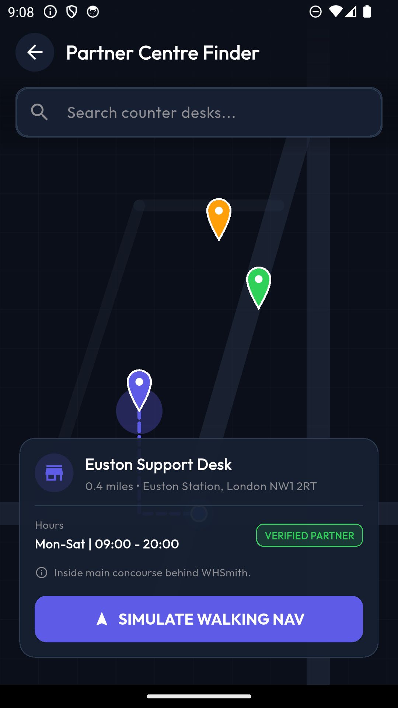
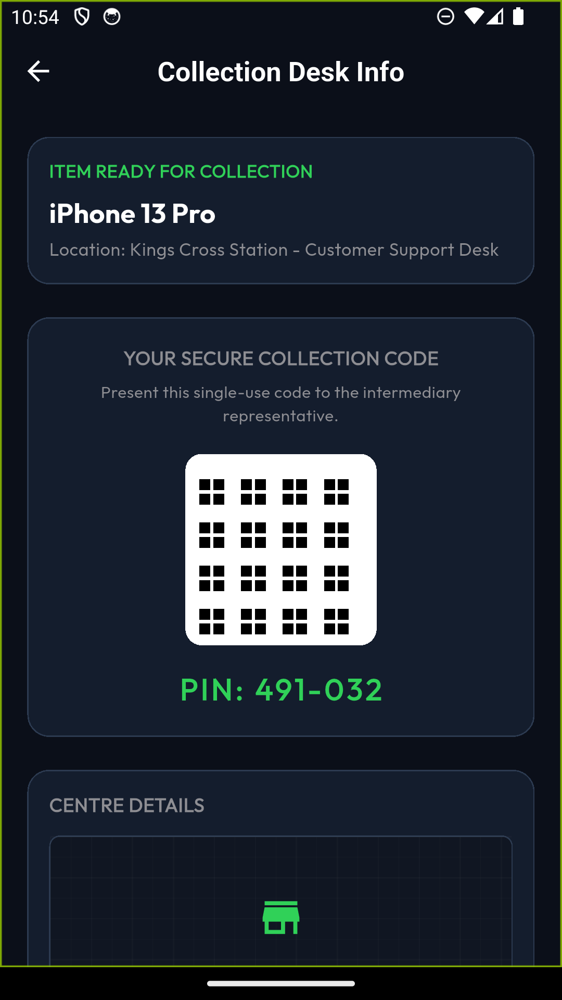
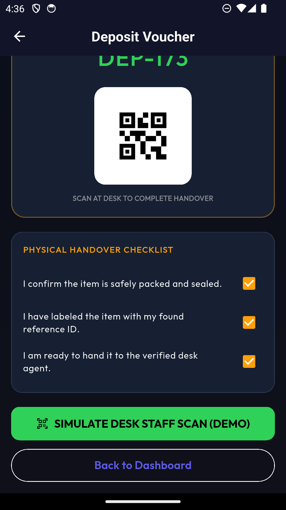
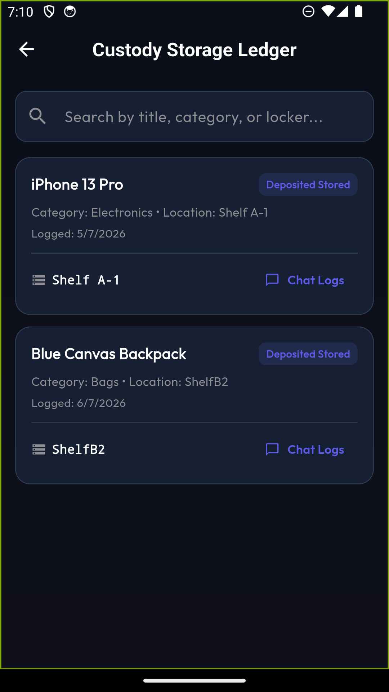
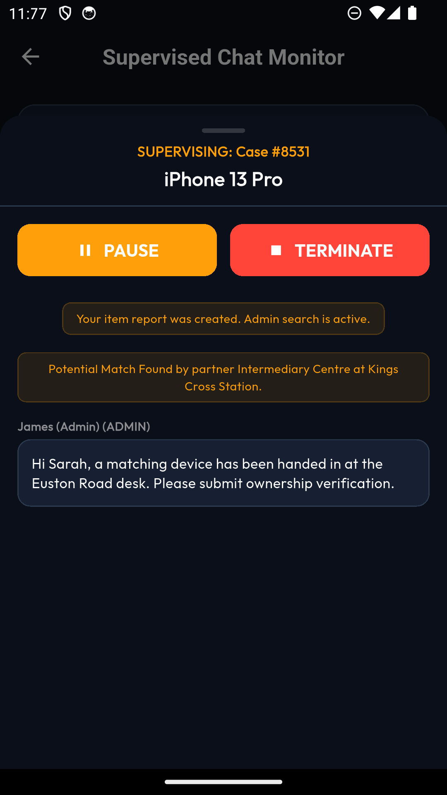

# UK National Lost-Item

A prototype of a safer lost-property recovery service.

**Portfolio prototype. All services are simulated.** The app runs on demo data held in memory. There is no server, no real sign-in, no payment and no identity check. Nothing you enter is sent anywhere, and everything resets when the app restarts.

## See it

- **Web demo:** _[PLACEHOLDER: web demo link]_
- **Two-minute video:** _[PLACEHOLDER: video link]_
- **Run it yourself:** see [Run it](#run-it).

<table>
  <tr>
    <td align="center"><br><sub>Owner: proving ownership</sub></td>
    <td align="center"><br><sub>Owner: simulated identity scan</sub></td>
    <td align="center"><br><sub>Owner: drop-off desk map (drawn)</sub></td>
    <td align="center"><br><sub>Owner: collection PIN</sub></td>
  </tr>
  <tr>
    <td align="center"><br><sub>Finder: deposit voucher</sub></td>
    <td align="center"><br><sub>Desk: storage ledger</sub></td>
    <td align="center"><br><sub>Admin: chat monitor</sub></td>
    <td></td>
  </tr>
</table>

## The problem and the idea

When someone finds a lost phone or wallet, the usual way to return it is to contact the owner and arrange to meet. Two strangers then share contact details, haggle over a reward and meet somewhere, and a thief can use the same route to "return" stolen goods for money. This design removes the direct contact. The finder hands the item in at a partner desk, the owner proves ownership to an admin board, and the board sets a fixed reward that is released only after the owner has collected the item.

## How it works

| Role | What they can do in the app |
|---|---|
| **Owner** | Report a lost item, follow its status, prove ownership of a match, see the drop-off desks on a map, get a collection PIN, message the admin team. |
| **Finder** | Report a found item, choose a drop-off desk, show a deposit voucher, see the reward wallet and its history, message the support team. |
| **Desk staff** (intermediary) | Check items in by PIN and record where they are stored, keep a storage ledger, hand items over against the owner's collection PIN. |
| **Admin board** | Review ownership claims, set the reward, approve or reject. Monitor, pause or end chats. Handle fraud reports, freeze cases, suspend and reinstate accounts. View the partner desks. |

Every role also has a notifications centre and a profile page with a data-rights centre. A fifth demo account shows what a suspended user sees.

### The recovery flow

1. The owner reports a lost item.
2. The finder reports a found item and chooses a partner drop-off desk. The app issues a deposit voucher with a PIN.
3. The finder hands the item in. Desk staff check it in by PIN and record its storage location.
4. The owner is told about a possible match. In this prototype the match is part of the demo data; there is no matching code.
5. The owner proves ownership: answers to questions set by the admin board, optional proof of purchase, and an identity scan for high-value items.
6. The admin board reviews the claim, sets the reward and approves or rejects it.
7. The owner receives a collection PIN and collects the item from the desk, where staff confirm the PIN.
8. The reward is released to the finder's wallet.

At no point do the owner and the finder see each other's details or message each other.

## Design principles

- **No direct contact between owner and finder.** Each talks only to the admin and support team; the desk handles the item.
- **The admin board sets the reward.** It is never negotiated, and the owner cannot set or change it.
- **Hand-over goes through a drop-off desk**, against a one-time PIN.
- **Proof of ownership comes before release.**
- **Chat is monitored.** The admin team can pause or end any conversation, and messages are filtered to hide email addresses, phone numbers and card numbers.
- **Minimal exposure of personal details.** Other users see a masked profile, and identifying details of an item are not shown publicly.

## What is real and what is simulated

In the app, every screen carries a PROTOTYPE ribbon, each simulated feature is marked SIMULATED, and "About this prototype" is linked from the sign-in and profile screens.

| Feature | In this prototype |
|---|---|
| Sign-in and accounts | Five built-in demo accounts; any password works. New accounts last until the app restarts. |
| Data | Reports, messages, notifications and rewards are demo data held in memory. Nothing is saved or shared between devices. |
| Matching lost and found reports | Not built. The match shown is part of the demo data. |
| Photos and documents | Tapping upload adds a placeholder file name. No file is read. |
| Drop-off desk map | A drawn picture with fixed example desks. No maps service, no location. |
| Identity scan | A timed animation that always succeeds. The camera is not used. |
| QR codes and desk scanning | The QR codes are drawings. Desk staff type the PIN, and "simulate scan" buttons move the demo along. |
| Rewards, escrow, wallet, withdrawal | Numbers in memory. No payment provider; no money moves. |
| Chat | Messages are kept in memory and seen by the other roles in the same session. Nothing is sent anywhere. |
| Notifications | Shown inside the app only. No push messages. |
| Data-rights centre (export, erasure) | Acts on the demo user only. |
| Police and stolen-property checks | Illustrative text only. No connection to any outside system. |

## How it is built

- **Flutter** (Dart 3.12), one code base for Android and iOS.
- **State:** `provider`, with two `ChangeNotifier` services: `AuthProvider` for the signed-in user and `ItemsService` for all demo data and actions.
- **Navigation:** `go_router`, with 28 routes and a redirect that keeps each role on its own screens and sends a suspended account to its own page.
- **Fonts:** `google_fonts`, which downloads the font files when the app first runs.

```text
lib/
  main.dart            app setup and routes
  core/
    models/            lost item, found item, reward transaction, fraud report, notification, user
    services/          AuthService, AuthProvider, ItemsService: the in-memory demo data layer
    theme/             colours and text styles
    widgets/           shared widgets
  features/
    auth/              sign-in, registration, suspended account
    owner/  finder/  intermediary/  admin/
    common/            notifications, profile and data rights
test/
  widget_test.dart
```

**Where a real backend would connect.** `ItemsService` and `AuthService` hold all the data and every change of state. A real version would replace their in-memory lists with calls to a backend. The screens get their data and actions from these services, so most of them would not need to change. The exception is the example desk list, which is written into the map and desk-manager screens.

## Run it

You need Flutter 3.44.2, the version the pipelines use, and an Android emulator or device. On a Mac you can also use the iOS simulator. Newer Flutter releases run the app too, but from 3.47 the analyser flags the `package:flutter/material.dart` import in every file as deprecated.

```bash
git clone https://github.com/romeoayofe25-collab/uk-national-lost-item.git
cd uk-national-lost-item
flutter pub get
flutter run
```

On the sign-in screen, tap a role button, or type one of these addresses with any password:

| Account | Role | Shows |
|---|---|---|
| `owner@test.com` | Owner | Sarah Jenkins, with a lost phone that has a possible match |
| `finder@test.com` | Finder | Marcus Vance, with a wallet balance and a found item to drop off |
| `intermediary@test.com` | Desk staff | Kings Cross Counter A |
| `admin@test.com` | Admin board | The admin console |
| `suspended@test.com` | Suspended owner | The suspended-account screen |

All roles share the same demo data while the app is running. Sign out, sign in as another role, and you will see the effect of what you just did.

### A two-minute tour

1. **Owner.** On the iPhone 13 Pro alert, tap **Provide Proof**. Run the simulated identity scan, fill in the answers and the serial number (any text will do) and submit.
2. **Admin.** Open the claim under "Pending claims verification review", set the reward and approve it.
3. **Owner.** Open the iPhone 13 Pro report and go to its collection details. The collection PIN is `491-032`.
4. **Desk staff.** Tap **Scan QR / PIN**, enter `491-032` and confirm the hand-over.
5. **Finder.** Open the wallet: the reward has moved from pending to available.
6. **Admin.** Open **Supervised Chats** and **Disputes & Fraud**.

## Tests and pipelines

```bash
flutter analyze
flutter test
```

The tests in `test/widget_test.dart` cover the data models; the service logic for ownership verification, desk check-in, fraud reports, notifications and data-rights actions; and widget tests that the app opens on the sign-in screen, that the notifications and profile screens render and respond, and that the prototype ribbon, the About screen and the SIMULATED tags appear.

Two pipelines run on pushes and pull requests to `main`, both on Flutter 3.44.2:

- **GitHub Actions** (`.github/workflows/build.yml`): analyse and test, then build an Android debug APK and an unsigned iOS app.
- **Codemagic** (`codemagic.yaml`): analyse, test, then build Android and unsigned iOS.

Nothing is signed for release. The Android release build uses the debug key, iOS builds are unsigned, and nothing is published to an app store.

## What a production version would need

- A backend with access rules, so each role sees only what it should and data persists.
- Matching of lost and found reports.
- Real identity checks through a regulated identity provider, with clear consent and retention rules.
- A regulated payment provider to hold and release rewards. The service itself should never hold the money.
- A network of partner desks, with agreements, trained staff and locked storage.
- Moderation staff for chats and disputes, and a route to the police for suspected stolen property.
- Data-protection work for identity data: a lawful basis, an impact assessment and retention limits.
- Release signing, an accessibility review and security testing.

## Decisions and lessons

> **[PLACEHOLDER: Martin to rewrite this section in his own words.]** Draft points:
>
> - Built the front end first, on in-memory data, to test whether a four-role flow holds together before paying for a backend.
> - Chose hand-over at a desk instead of a meeting. Safer for both sides, but the service then depends on partner desks it does not control.
> - Took reward-setting away from the owner to stop haggling and ransom-style demands. The cost is admin work on every claim.
> - Wired in Firebase early but never switched it on, then removed it so the code shows what the app really does.
> - Learned to label simulations plainly: a convincing mock-up of an identity scan or a payment can mislead.
> - (Optional) Why the project stops at a prototype.

## Author

Martin Adegbola Traore. _[PLACEHOLDER: contact link]_

## Notice

© 2026 Martin Adegbola Traore. All rights reserved.

This is an independent project. It is not affiliated with, endorsed by or connected to any police force, government body, transport operator or retailer. Real place names appear only as example locations. All people, accounts and items in the demo data are fictional.
